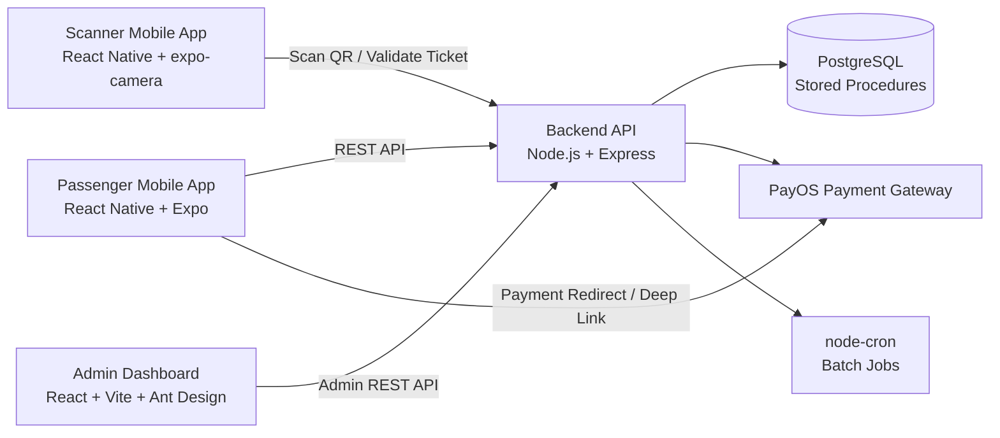
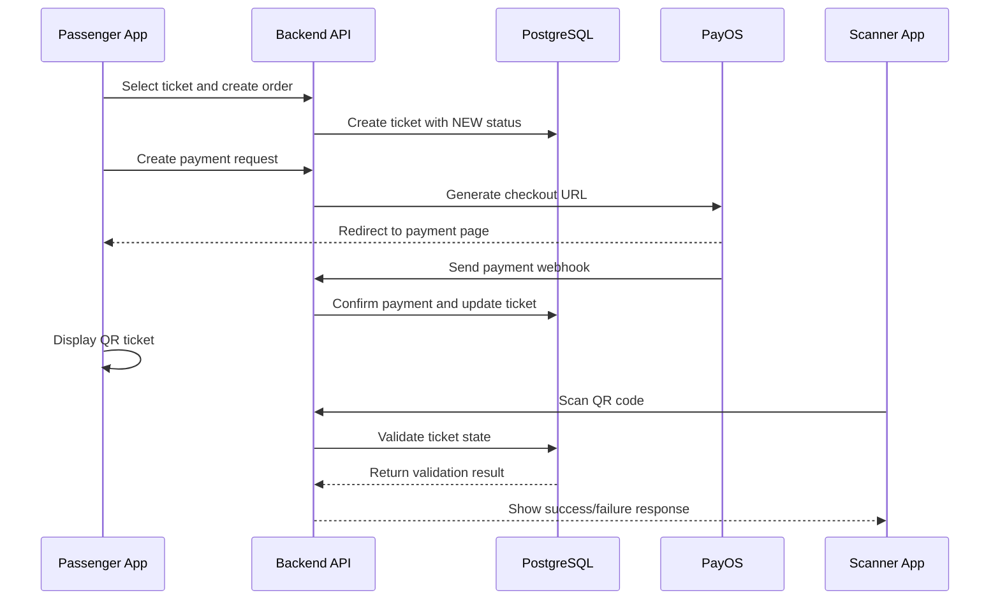
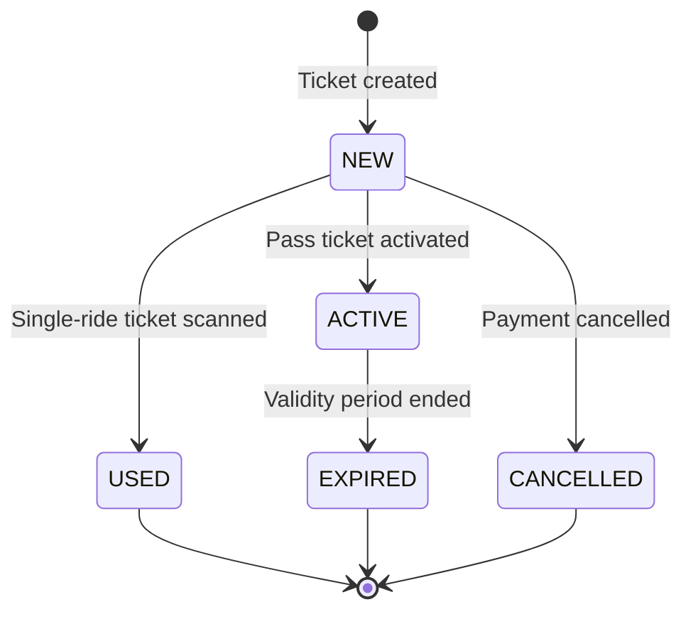
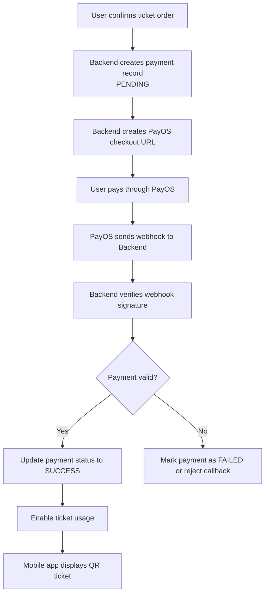

# 🚇 Metro HCMC -- Digital Ticketing Platform

> A multi-platform metro ticketing system for Ho Chi Minh City Metro, featuring mobile ticket purchase, PayOS payment integration, QR-based ticket validation, and an admin dashboard for transit operations.

## 📌 Overview

Metro HCMC is a digital ticketing platform designed for urban rail transportation. The system allows passengers to purchase metro tickets through a mobile app, complete payments through PayOS, view QR-based tickets, and validate tickets through a dedicated scanner app used by station inspectors.

The project consists of **4 coordinated applications**:

- **Backend API** for authentication, ticketing, payment, scanner validation, and admin operations
- **Admin Dashboard** for metro operators to manage stations, routes, ticket products, reports, and users
- **Passenger Mobile App** for buying tickets, viewing QR tickets, and using an interactive metro map
- **Scanner Mobile App** for inspectors to scan QR codes and simulate station check-in/check-out validation

---

## 🔗 Repositories

> Replace the placeholders below with your actual repository links.

| Repository | Description | Tech Stack | Link |
|-----------|-------------|------------|------|
| Backend API | REST API for tickets, payments, scanner validation, admin operations, and batch jobs | Node.js, Express, PostgreSQL, PayOS | **[Backend Repository](PASTE_BACKEND_REPO_LINK_HERE)** |
| Admin Dashboard | Web dashboard for managing stations, ticket products, reports, users, and system data | React, Vite, TypeScript, Ant Design | **[Admin Dashboard Repository](PASTE_ADMIN_REPO_LINK_HERE)** |
| Passenger Mobile App | Mobile app for ticket purchase, payment, QR ticket display, and metro map features | React Native, Expo, TypeScript | **[Passenger App Repository](PASTE_PASSENGER_APP_REPO_LINK_HERE)** |
| Scanner Mobile App | Mobile app for station inspectors to scan and validate QR tickets | React Native, Expo, expo-camera | **[Scanner App Repository](PASTE_SCANNER_APP_REPO_LINK_HERE)** |

---

## ✨ Key Features

- **Multi-platform architecture** with backend API, admin web dashboard, passenger mobile app, and scanner mobile app
- **Ticket purchasing flow** for single-ride tickets and multi-day pass tickets
- **PayOS payment integration** with webhook verification, payment status handling, mobile deep-link redirects, and demo payment mode
- **QR-based ticket validation** using a dedicated scanner app with camera-based barcode scanning
- **Ticket lifecycle state machine** implemented with PostgreSQL stored procedures
- **Check-in/check-out simulation** for station gate validation
- **Interactive metro map** with GPS-based nearest station detection and route visualization
- **Admin dashboard** for managing metro lines, stations, fare rules, ticket products, customers, reports, and audit logs
- **Batch jobs** for automated ticket activation, expiration, and cleanup of unpaid tickets
- **Role-based access control** for Customer, Admin, and Inspector users

---

## 🧰 Tech Stack

| Layer | Technologies |
|------|--------------|
| Backend | Node.js, Express.js, PostgreSQL, PayOS SDK |
| Database | PostgreSQL, raw SQL, stored procedures |
| Admin Web | React, Vite, TypeScript, Ant Design, Recharts |
| Mobile Apps | React Native, Expo, TypeScript |
| Scanner | expo-camera, QR/barcode scanning |
| Maps | react-native-maps, Leaflet |
| Payment | PayOS, webhook verification, mobile deep links |
| Scheduling | node-cron |
| API Documentation | Swagger / OpenAPI |

---

## 🏗️ System Architecture



---

## 🎫 Core Business Flow



---

## 🔁 Ticket Lifecycle

The ticket lifecycle is managed through PostgreSQL stored procedures to keep validation logic consistent and centralized.



### Lifecycle Highlights

- Single-ride tickets transition from `NEW` to `USED` after successful validation
- Pass tickets transition from `NEW` to `ACTIVE` and remain valid until expiration
- Expired, used, or cancelled tickets are rejected during validation
- Each scan creates validation records and audit logs
- Batch jobs automatically activate, expire, and clean up tickets when needed

---

## 💳 Payment Flow

The system integrates **PayOS** for ticket payment processing.



Key implementation details:

- PayOS SDK configuration
- HMAC-SHA256 webhook verification
- Payment status handling: `PENDING`, `SUCCESS`, `FAILED`
- Mobile deep-link redirects after payment
- Demo payment mode for development and testing
- Idempotent confirmation handling to avoid duplicate payment processing

---

## 📱 My Contributions

My confirmed contributions focused on the core passenger ticketing, payment, QR validation, and map features.

### Backend

- Authored PostgreSQL stored procedures for ticket creation, payment confirmation, and ticket validation
- Implemented ticket lifecycle logic for `NEW`, `ACTIVE`, `USED`, `EXPIRED`, and `CANCELLED` states
- Built REST API endpoints for ticket creation, payment processing, and scanner validation
- Integrated PayOS payment gateway with webhook verification and mobile redirect handling
- Implemented batch jobs using `node-cron` for ticket activation, expiration, and unpaid ticket cleanup

### Passenger Mobile App

- Developed the end-to-end ticket purchasing flow
- Built station selection, order confirmation, payment handling, and payment success screens
- Implemented QR ticket display and ticket history views
- Built an interactive metro map with GPS-based nearest station detection

### Scanner Mobile App

- Built the scanner app from scratch
- Implemented QR scanning using `expo-camera`
- Added station selection and check-in/check-out simulation
- Integrated scanner validation with the backend API
- Added visual feedback, haptic feedback, and automatic reset after each scan

---

## 🚀 Getting Started

This repository is an overview/documentation repository.

To run the full system, clone and set up each repository separately:

1. Backend API
2. Admin Dashboard
3. Passenger Mobile App
4. Scanner Mobile App

Detailed setup instructions should be placed in each individual repository.

Recommended setup order:

```text
1. Start PostgreSQL database
2. Start Backend API
3. Start Admin Dashboard
4. Start Passenger Mobile App
5. Start Scanner Mobile App
```

---

## ⚠️ Security Notes

Before making the repositories public, make sure the following files and values are not committed:

- `.env`
- Database URLs
- PayOS credentials
- JWT or session secrets
- API keys
- Private certificates
- Real user data
- Admin account credentials

Use `.env.example` files instead of real environment files.

---

## 👥 Team Project Notice

This was a team project. My main ownership covered:

- Ticket purchasing flow
- PayOS payment integration
- QR-based ticket validation
- Scanner mobile app
- PostgreSQL ticket lifecycle logic
- Interactive metro map features

Other modules such as authentication, face authentication, gift code/promotion management, and admin dashboard pages were implemented by other team members.

---

## 📄 License

Academic project for learning and portfolio purposes.